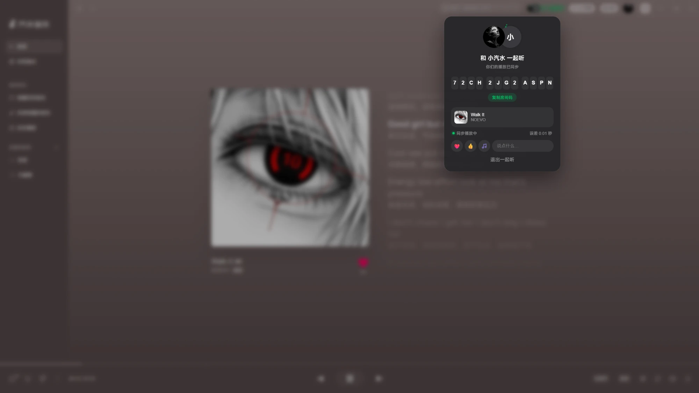
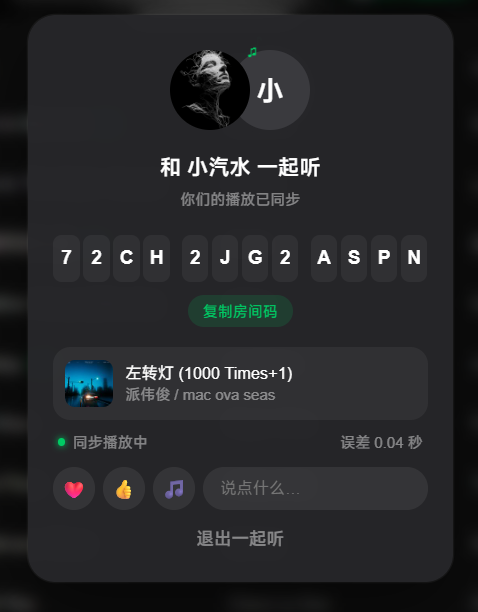
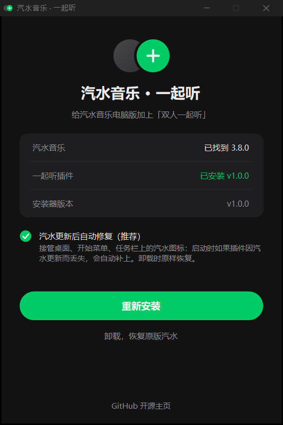

<h1 align="center">汽水音乐一起听（电脑版插件）</h1>

给<b>汽水音乐电脑版</b>加上「双人一起听」——和手机版一样的入口，像网易云音乐一起听一样真的能同步听歌。

<a href="../../releases/latest"><b>⬇ 下载 SodaTogether.exe</b></a>

---

汽水音乐手机版有「一起听」，电脑版（PC 版 / Windows 客户端）却没有。这个插件把一起听带到汽水音乐电脑版：装好后汽水顶栏会多出「一起听」按钮，创建房间、把房间码发给好友，两个人就能同步听同一首歌。

- **真正同步**：切歌、播放 / 暂停、拖动进度实时同步，还能互发表情和文字
- **听感顺滑**：两边的小误差会悄悄追平，不会突然跳一下，开着语音一起听也没有回音感
- **原生体验**：入口在汽水顶栏和「听歌模式」页，界面、配色、动效都按汽水自己的风格做
- **装好就能用**：不需要自己搭服务器，复制邀请发给好友，对方打开「一起听」会自动识别房间码，一键加入
- **每人用自己的账号播放**：不传音频，只同步「哪首歌、播到哪」
- **汽水自动更新也不怕**：插件被汽水更新冲掉时会自动补上；万一和新版汽水不兼容，插件会自动停用，汽水照常使用
- **新版本提醒**：插件有新版本时，「一起听」里会提示下载

> [!WARNING]
> 本项目通过修改汽水音乐客户端的界面文件实现，**不符合汽水音乐用户协议**，与字节跳动 / 汽水音乐官方无关。请自行评估风险，仅用于个人和朋友间使用。仓库中不包含任何汽水音乐的文件。

## 界面预览

<table>
<tr>
<td align="center" width="50%"> 一起听面板：同步状态、播放误差、表情和聊天</td>
<td align="center" width="50%"> 安装器：一键安装 / 卸载</td>
</tr>
</table>

 汽水顶栏的「一起听」入口

## 安装

1. 到 [Releases](../../releases/latest) 下载 **`SodaTogether.exe`**
2. 双击运行，点「安装」
3. 汽水顶栏点 **「一起听」** → 创建房间 → 点「复制邀请」发给好友
4. 好友也装好插件后，复制你的邀请、打开「一起听」，点「一键加入」即可

第一次运行如果出现 Windows「已保护你的电脑」：点「更多信息」→「仍要运行」。

想卸载：再次运行 `SodaTogether.exe`，点「卸载，恢复原版汽水」。

系统要求：Windows 10 / 11，汽水音乐电脑版。

已测试版本：汽水音乐电脑版 3.8.0。

## 安装器会改什么

- 只修改汽水音乐自己的一个界面文件（`main.asar`），修改前会自动备份为 `main.asar.orig`
- 把桌面 / 开始菜单 / 任务栏上的汽水图标改为先经过本插件再启动汽水（图标不变），用于汽水更新后自动补上插件
- 不需要管理员权限，不安装驱动或后台服务，不修改系统设置
- 卸载会恢复原文件和原快捷方式，并删除插件自己的文件

## 隐私说明

- 一起听时，经过公共中转服务器的只有：房间里正在听的歌曲、播放进度和状态、你的汽水昵称和头像链接、你发送的表情和文字
- 这些内容都经过加密，只有拿到房间码的人能看到；不传输音频、账号或登录信息
- 中转服务器由第三方免费提供（EMQX、HiveMQ），所有人退出后房间信息会被清除
- 插件每 6 小时最多访问一次 GitHub，检查是否有新版本
- 打开「一起听」时，插件会读取剪贴板，只用来识别好友发来的房间码，不会保存或上传剪贴板内容

## 使用提示

- 房间码只私下发给要一起听的朋友，不用时点「退出一起听」。
- 请只从本仓库的 [Releases](../../releases/latest) 下载安装器。

## 常见问题

**汽水更新后「一起听」不见了？** 用桌面 / 开始菜单 / 任务栏上的汽水图标打开，会自动补上；或者重新运行一次 `SodaTogether.exe`。

**杀毒软件拦截？** 安装器会修改汽水音乐的界面文件，部分杀毒软件会提示，选择允许即可。

**连接不上？** 可以在「一起听」面板底部点「高级」，填写自己的服务器地址（MQTT over WebSocket，例如 `wss://example.com:8084/mqtt`），双方需要填写相同的地址。

**能和手机版汽水一起听吗？** 不能，只能在都装了本插件的电脑之间一起听。

**会员歌曲？** 每个人用自己的账号播放，需要双方都有对应权限。

## English

**Soda Music Listen Together** — a plugin that adds "Listen Together" to the Soda Music (汽水音乐 / Qishui Music) desktop app for Windows. Create a room, share the code with a friend, and your playback (song, play / pause, seek) stays in sync. Download `SodaTogether.exe` from [Releases](../../releases/latest).

## 许可

[MIT](LICENSE)
